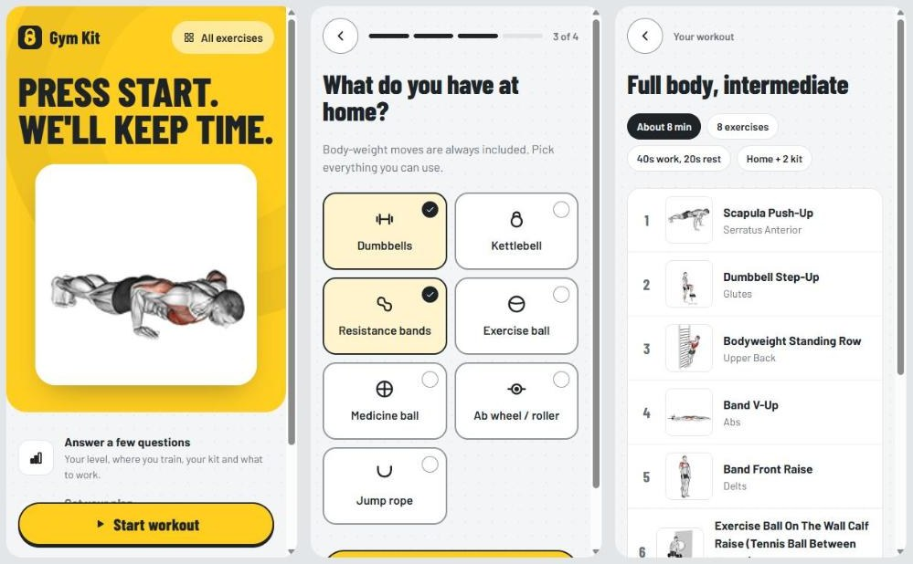
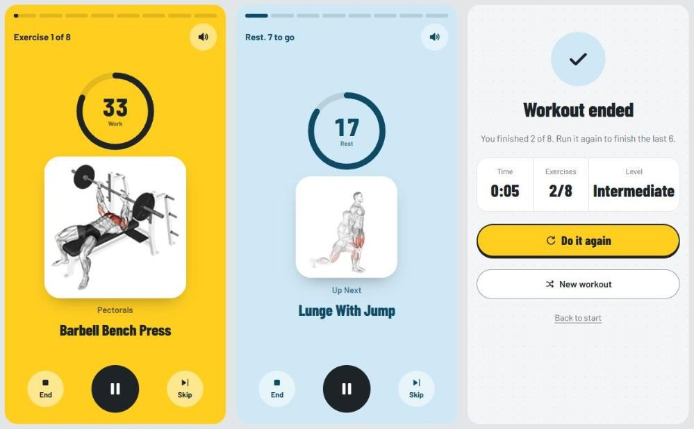

# Gym Kit

**Press start. We'll keep time.**

Gym Kit is a guided workout timer for your phone. Answer a few quick questions, get a workout built for your level, equipment and goal, then follow the screen: countdown, exercise, rest, repeat. No account, no setup, no planning.



---

## Who it's for

People who want to train today without working out *what* to do:

- **Beginners** who don't know which exercises to pick or how long to rest.
- **Home trainers** with a mat and maybe a pair of dumbbells.
- **Gym-goers** who want a structured session instead of wandering between machines.

## How it works

1. **Tell it about you** (about 10 seconds)
   - **Level:** Starter, Intermediate or Expert
   - **Where:** Home or Gym
   - **Home kit:** dumbbells, kettlebell, resistance bands, exercise ball, medicine ball, ab wheel or jump rope. Body weight is always included.
   - **Focus:** full body, upper body, lower body or core
2. **Review your plan.** See every exercise with its demo animation, the total time and the timings. Don't like it? **Shuffle**.
3. **Train.** A 3-2-1 countdown, then the screen guides you through every exercise and rest.
4. **Finish.** See your time and exercises done, then **Do it again** or start a new workout.

Next time, **Same as last time** gets you back into the same kind of workout in one tap.

## Built for the floor, not the desk



During a workout your phone is on the floor a metre or two away, and your hands are busy. Everything on the workout screen is designed for that:

- **The whole screen is the signal.** It's yellow for work and blue for rest, so you can read it from across the room at a glance.
- **You don't need to look.** Beeps count down the last 3 seconds and sound when each set starts, and the phone buzzes on each switch. Sound can be muted, and the setting is remembered.
- **The timer ring drains as time runs out**, and a row of pills (one per exercise) shows how far you are through the workout.
- **Big controls in the thumb zone.** The large centre button pauses and resumes. **End** needs a second tap, so a sweaty slip doesn't throw your workout away.
- **Rest shows what's next**, so you're set up before the next set starts.
- **The screen stays awake** during the workout on phones that support it.
- **Keyboard:** Space pauses, → skips.

## Levels

| Level | Exercises | Work | Rest | About |
|---|---|---|---|---|
| Starter | 6 | 30 s | 30 s | 6 min |
| Intermediate | 8 | 40 s | 20 s | 8 min |
| Expert | 10 | 45 s | 15 s | 10 min |

## How a workout is chosen

Gym Kit picks from a library of 1,284 animated exercises, with rules a coach would apply:

- **Only what you can do.** Home workouts use only the kit you ticked, and skip moves that need a bar, bench or machine.
- **Right for your level.** Skill moves (planche, handstand, archer and clap push-ups) are expert only. Jumps, burpees, pistol squats and Olympic lifts are left out for Starters. Lower levels draw from familiar movements: squats, lunges, push-ups, planks, rows and presses.
- **Balanced.** Full-body workouts rotate muscle groups. Lower-body workouts pair two thigh or glute moves with each calf move.
- **No repeats.** A workout never contains two forms of the same move (no "push-up" plus "push-up (on knees)"). The library itself has no duplicates.

## Exercise library

Browse every exercise with its animation, target muscles, equipment and step-by-step instructions. Filter by **Home** or **Gym** and by muscle group (arms, back, calves, chest, core, forearms, legs, shoulders and more), or search by name, muscle or equipment.

## Design

Gym Kit's look is **plate and chalk**, taken from the gym floor: bumper-plate yellow, chalk white, iron grey.

| | Colour | Used for |
|---|---|---|
| Plate | `#FFCE1F` | the one main action on each screen; the work screen |
| Recovery | `#CFE8F5` | the rest screen |
| Iron | `#1E2328` | text, the countdown screen |
| Chalk | `#F4F5F6` | page background, with a faint rubber-floor speckle |

Headlines and the timer use **Barlow Condensed**, a scoreboard-style face. Body text uses **Barlow**.

The interface follows established UX principles:

- **Fitts's law:** the most-used control during a set is the biggest one.
- **Hick's law:** at most 4 choices per question.
- **Goal-gradient effect:** progress pills, plus "Last one" and "2 to go" labels.
- **Peak-end rule:** a finish screen with your stats.
- **Zeigarnik effect:** ending early shows what's left and offers to run it again.

Accessibility:

- control borders meet 3:1 contrast
- visible keyboard focus
- screen-reader labels on icon buttons
- dark mode, and reduced motion respected

## Run it locally

Requires Node.js 20+.

```bash
npm install
npm run import-exercises -- "<path to exercises-dataset-main>"   # once: copies exercise data and media
npm run dev
```

Open http://localhost:3000. On a phone, open your computer's local IP address on port 3000 (same Wi-Fi).

| Command | What it does |
|---|---|
| `npm run dev` | Development server |
| `npm run build` / `npm start` | Production build (every exercise page is prerendered) and server |
| `npm test` | Tests for how workouts are built |
| `npm run lint` | ESLint |
| `npm run import-exercises` | Imports the dataset: English text only, duplicates removed, media copied to `public/exercises/` |

**Built with** Next.js 16, React 19 and TypeScript, with no other runtime dependencies. Icons, the logo and the timer are hand-made SVG, and the beeps use the Web Audio API, so there are no sound files.

<details>
<summary>Project layout</summary>

| Path | What's there |
|---|---|
| `app/page.tsx` | Start screen |
| `app/workout/`, `components/WorkoutFlow.tsx` | Questions, plan, countdown, timer, finish |
| `app/exercises/` | Library and exercise pages |
| `lib/workout.ts` | How a workout is built: levels, focus, home kit, filters |
| `lib/exercises.ts`, `lib/bodyParts.ts` | Dataset access, home vs gym, muscle-group names |
| `scripts/import-exercises.mjs` | Dataset import |

</details>

## Exercise media licence

The exercise images and animations, including those in the screenshots above, are **© Gym Visual** ([gymvisual.com](https://gymvisual.com)). They're fine for local development. **License them from Gym Visual before publishing Gym Kit.** The media folder (`public/exercises/`) is not committed to git.
